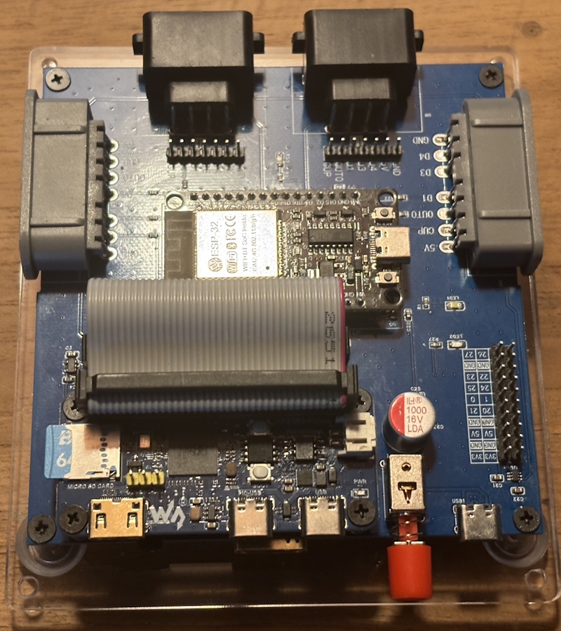
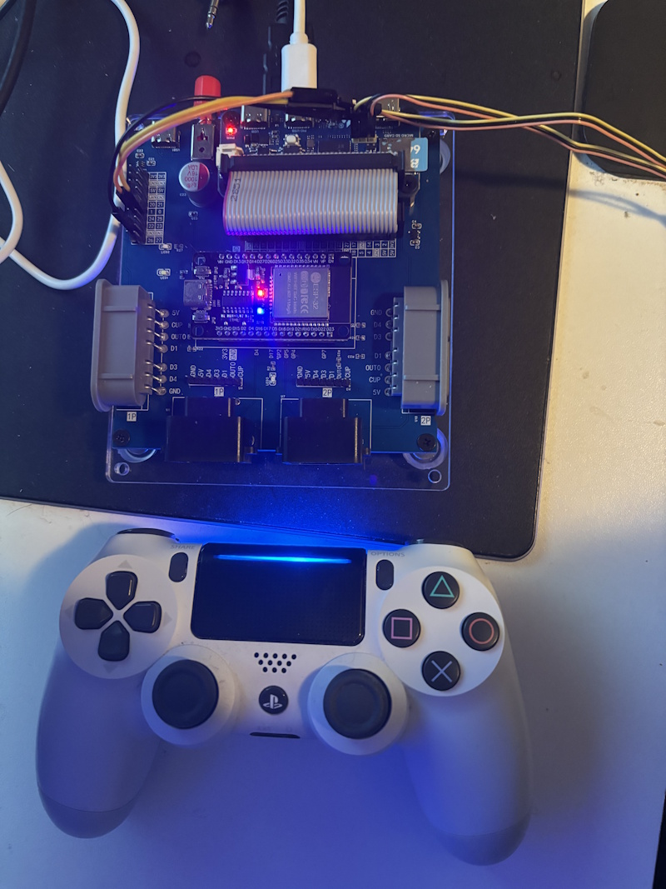
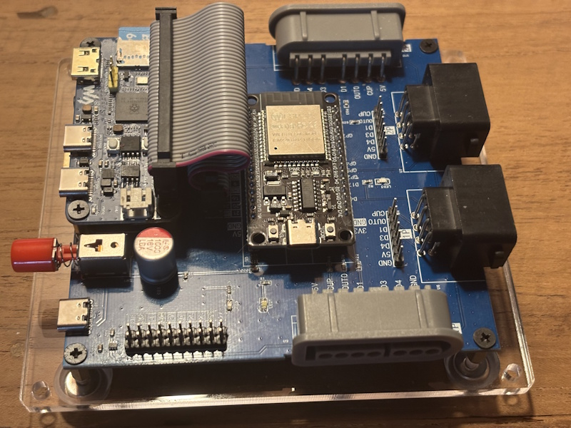
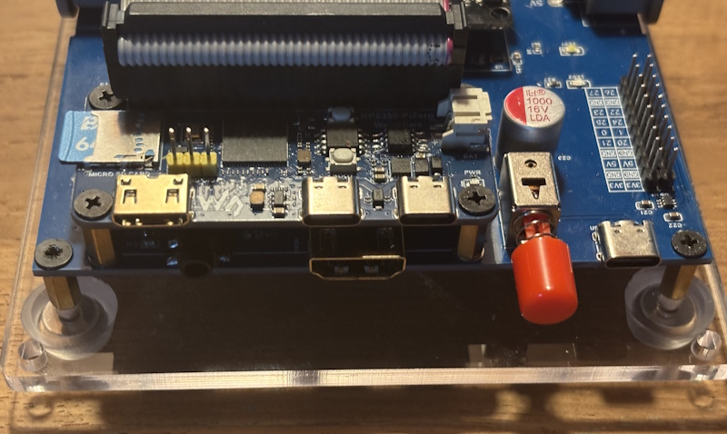

# PicoPeanutGB, a Game Boy and Game Boy Color emulator for the Raspberry Pi Pico 2 (RP2350) and Pico (RP2040)

PicoPeanutGB is a Game Boy (DMG) and Game Boy Color emulator for RP2350 based microcontroller boards like the Raspberry Pi Pico 2, with picture and sound over HDMI and games loaded from an SD card. It also runs on the original RP2040 based Raspberry Pi Pico, in Game Boy (DMG) form only — see [Running on the Raspberry Pi Pico (RP2040)](#running-on-the-raspberry-pi-pico-rp2040).

The emulator core is a port of [Peanut-GB](https://github.com/deltabeard/Peanut-GB), a single header Game Boy (DMG) emulator written in C by Mahyar Koshkouei. Game Boy Color support comes from the [gbc-rtc-fix branch](https://github.com/tvecera/Peanut-GB/tree/gbc-rtc-fix) by [@tvecera](https://github.com/tvecera), the work behind Peanut-GB [PR #93](https://github.com/deltabeard/Peanut-GB/pull/93).

Video output uses the RP2350's HSTX hardware where the board configuration supports it, using the [pico_hdmi driver](https://github.com/fliperama86/pico_hdmi) by [@fliperama86](https://github.com/fliperama86). The remaining configurations use PicoDVI, based on [Shuichi Takano's Pico-InfoNes project](https://github.com/shuichitakano/pico-infones), which in turn is based on [PicoDVI](https://github.com/Wren6991/PicoDVI). Sound normally travels with the picture in the HDMI stream; boards with a DAC or line-out jack can output it separately instead.

Put your DMG Game Boy (.gb) or Game Boy Color (.gbc) rom files,  and optional [metadata](#using-metadata) on a FAT32 or exFAT formatted SD card. Preferred location for roms: /roms/GB You can organize the roms in directories. A menu is displayed on which you can select the rom to play. The last 20 games you started are kept in a [recently played list](#recently-played-games), one button press away in the menu.

> [!NOTE]
> The emulator runs best on the Raspberry Pi Pico 2. Some Game Boy Color games have image and sound glitches.
> Releases for the original Raspberry Pi Pico (RP2040) are available again, but with real limitations — see [Running on the Raspberry Pi Pico (RP2040)](#running-on-the-raspberry-pi-pico-rp2040).

## System requirements - What do you need?

> [!NOTE]
> For detailed instructions and specific configurations, see the [Pico-InfonesPlus sister project](https://github.com/PicoPlus-devel/pico-infonesPlus). 

### Hardware

One of the boards below, a display with an HDMI input and an SD card. A USB game controller is the easiest way to play, but legacy controllers work too — see [Gamepad and keyboard usage](#gamepad-and-keyboard-usage).

The RP2350 boards play both Game Boy and Game Boy Color games. The RP2040 boards play Game Boy (DMG) games only, with the limitations described [below](#running-on-the-raspberry-pi-pico-rp2040).

#### RP2350 boards (Game Boy and Game Boy Color)

| Configuration | Setup | Notes |
| --- | --- | --- |
| **Raspberry Pi Pico 2 / Pico 2 W** on a breadboard with the [Adafruit DVI breakout](https://www.adafruit.com/product/4984) and [Adafruit microSD breakout](https://www.adafruit.com/product/254) | [Setup](https://github.com/PicoPlus-devel/pico-infonesPlus/blob/main/README.md#raspberry-pi-pico-or-pico-2-setup-with-adafruit-hardware-and-breadboard) | No soldering required. |
| **Raspberry Pi Pico 2 / Pico 2 W** on the [PicoNES PCB](#picones-pcb) | [Setup](https://github.com/PicoPlus-devel/pico-infonesPlus/blob/main/README.md#pcb-with-raspberry-pi-pico-or-pico-2-and-pimoroni-pico-plus-2) | Same binary as the breadboard build. Console-style carrier with controller ports and an optional 3D printed case. |
| **Raspberry Pi Pico 2** on a [Pimoroni Pico DV Demo Base](https://shop.pimoroni.com/products/pimoroni-pico-dv-demo-base?variant=39494203998291) | [Setup](https://github.com/PicoPlus-devel/pico-infonesPlus/blob/main/README.md#raspberry-pi-pico-or-pico-2-setup-for-pimoroni-pico-dv-demo-base) | Audio can be switched to the line-out jack. Use the Pico 2 binary on a Pico 2 W as well: the onboard LED driver conflicts with I2S audio here, so no W build is published. |
| [**Pimoroni Pico Plus 2**](https://shop.pimoroni.com/products/pimoroni-pico-plus-2?variant=42092668289107) | Use the breadboard or Pimoroni Pico DV Demo Base setup | Roms are loaded into the onboard PSRAM instead of flash. Fits the [PicoNES PCB](#picones-pcb) v2.6 or v2.8, provided male headers are soldered on. |
| [**Adafruit Metro RP2350**](https://www.adafruit.com/product/6003), also [with PSRAM](https://www.adafruit.com/product/6267) | [Setup](https://github.com/PicoPlus-devel/pico-infonesPlus/blob/main/README.md#adafruit-metro-rp2350) | With PSRAM fitted, roms are loaded into PSRAM instead of flash. Works fine without it. |
| [**Adafruit Fruit Jam**](https://www.adafruit.com/product/6200) | [Setup](https://github.com/PicoPlus-devel/pico-infonesPlus/blob/main/README.md#adafruit-fruit-jam) | Nothing else needed but a USB gamepad. Built-in speaker with volume control and a NeoPixel VU meter. Roms are loaded into PSRAM. |
| [**Waveshare RP2350-PiZero**](https://www.waveshare.com/rp2350-pizero.htm) | [Setup](https://github.com/PicoPlus-devel/pico-infonesPlus/blob/main/README.md#waveshare-rp2040rp2350-pizero-development-board) | Supports the optional PSRAM chip. [3D printed case](https://github.com/PicoPlus-devel/pico-infonesPlus/blob/main/README.md#3d-printed-case-for-rp2040rp2350-pizero) available. |
| **Waveshare RP2350-Zero** on the [PicoNES Mini PCB](#picones-mini-pcb) | [Setup](https://github.com/PicoPlus-devel/pico-infonesPlus/blob/main/README.md#pcb-with-waveshare-rp2040rp2350-zero) | PCB required, advanced soldering. |
| **Waveshare RP2350-USB-A** on the [PicoNES Micro PCB](#picones-micro-pcb) | [Setup](https://github.com/PicoPlus-devel/pico-infonesPlus/blob/main/README.md#pcb-with-waveshare-rp2350-usb-a) | PCB required, USB controller only. The most demanding of the three builds. |
| [**SpotPear HDMI**](https://spotpear.com/index/product/detail/id/1207.html) | — | No setup section; wire the board according to its own documentation. |
| **Murmulator M1** with a Pico 2 | — | See [murmulator.ru](https://murmulator.ru). Untested by me, please report any issues. |
| **Murmulator M2** | — | RP2350 only. See [murmulator.ru](https://murmulator.ru). Untested by me, please report any issues. |
| [**Olimex RP2040-PICO-PC**](https://www.olimex.com/Products/MicroPython/PICO/RP2040-PICO-PC/) with a Raspberry Pi Pico 2 | [Setup](https://github.com/PicoPlus-devel/pico-infonesPlus/blob/main/README.md#olimex-rp2040-pico-pc) | Sound through HDMI and the audio jack. USB controller on the USB-A port, NES or SNES controller on the UEXT connector. No Pico 2 W binary. |
| [**Pico Computer 3**](https://github.com/UKTailwind/Pico-Computer-3) | [Setup](https://github.com/PicoPlus-devel/pico-infonesPlus/blob/main/README.md#pico-computer-3) | Roms are loaded into the onboard PSRAM. Sound through HDMI or the audio jack. USB controllers on the USB-A ports, NES or SNES controllers and a Wii Classic controller on the I/O header. The pin assignment may still change. |
| [**PCB for the Waveshare RP2350-PiZero**](https://github.com/PicoPlus-devel/pico-infonesPlus#pcb-with-waveshare-rp2350-pizero), designed by Liu Szuping | [Setup](https://github.com/PicoPlus-devel/pico-infonesPlus/blob/main/README.md#pcb-with-waveshare-rp2350-pizero) | Sound through HDMI or the audio jack. USB controller on the PIO-USB port, NES or SNES controllers in the controller ports, or Bluetooth controllers through an ESP32 module running [BlueRetro](https://github.com/darthcloud/blueretro). Supports the optional PSRAM chip. The PCB design is not yet available. |

#### RP2040 boards (Game Boy only)

| Configuration | Setup |
| --- | --- |
| **Raspberry Pi Pico** on a breadboard with the [Adafruit DVI breakout](https://www.adafruit.com/product/4984) and [Adafruit microSD breakout](https://www.adafruit.com/product/254), or on the [PicoNES PCB](#picones-pcb) | [Setup](https://github.com/PicoPlus-devel/pico-infonesPlus/blob/main/README.md#raspberry-pi-pico-or-pico-2-setup-with-adafruit-hardware-and-breadboard) |
| **Raspberry Pi Pico** on a [Pimoroni Pico DV Demo Base](https://shop.pimoroni.com/products/pimoroni-pico-dv-demo-base?variant=39494203998291) | [Setup](https://github.com/PicoPlus-devel/pico-infonesPlus/blob/main/README.md#raspberry-pi-pico-or-pico-2-setup-for-pimoroni-pico-dv-demo-base) |
| [**Adafruit Feather RP2040 DVI**](https://www.adafruit.com/product/5710) with an SD reader | [Setup](https://github.com/PicoPlus-devel/pico-infonesPlus/blob/main/README.md#adafruit-feather-rp2040-with-dvi-hdmi-output-port-setup) |
| [**Waveshare RP2040-PiZero**](https://www.waveshare.com/rp2040-pizero.htm) | [Setup](https://github.com/PicoPlus-devel/pico-infonesPlus/blob/main/README.md#waveshare-rp2040rp2350-pizero-development-board) |

The binary specific for your config and optional PCB gerber files can be downloaded from the [releases](https://github.com/PicoPlus-devel/pico-peanutGB/releases/latest) page.

## Custom PCBs

Four community PCB designs turn a supported board and its breakouts into a small console. Nothing changes in the firmware: flash the binary for that configuration. Parts lists, ordering instructions, assembly notes, the pin assignment, the 3D-printed cases and the older design versions are described in the [PCB README](https://github.com/PicoPlus-devel/pico_shared/blob/main/PCB/README.md). The Gerber files are attached to every [release](https://github.com/PicoPlus-devel/pico-peanutGB/releases/latest) of this project.

| Design | Picture | Controller ports | Board it carries | Build | Designed by |
| --- | --- | --- | --- | --- | --- |
| [PicoNES v2.6](#picones-pcb) |  See note | 2 × NES | Pico 2, Pico 2 W, Pimoroni Pico Plus 2 or an original Pico | `-c2` | [John Edgar Park](https://twitter.com/johnedgarpark) |
| [PicoNES v2.8](#picones-pcb) |  See note | 2 × SNES | Pico 2, Pico 2 W, Pimoroni Pico Plus 2 or an original Pico | `-c2` | [John Edgar Park](https://twitter.com/johnedgarpark) |
| [PicoNES Mini](#picones-mini-pcb) |  | 2 × NES | Waveshare RP2350-Zero | `-c6` | [Gavin Knight](https://github.com/DynaMight1124) |
| [PicoNES Micro](#picones-micro-pcb) |  | None, USB controller only | Waveshare RP2350-USB-A | `-c9` | [Gavin Knight](https://github.com/DynaMight1124) |

> [!NOTE]
> The PicoNES v2.6 and v2.8 are shown with a Pimoroni Pico Plus 2. A Raspberry Pi Pico 2, Pico 2 W or original Pico can also be fitted.

A fifth design, the [PCB for the Waveshare RP2350-PiZero](https://github.com/PicoPlus-devel/pico-infonesPlus#pcb-with-waveshare-rp2350-pizero) by Liu Szuping, is supported by the emulator, but the design is not yet available.

|  |  |
|:--:|:--:|
|  |  |

> [!NOTE]
> Sellers on AliExpress have copied the PicoNES design and sell ready-made boards. For questions about those, contact the seller.

### PicoNES PCB

The PicoNES PCB carries the microcontroller board, the DVI and microSD breakouts and two controller ports. It comes in two versions, which differ only in the controller ports: **v2.6** with NES controller ports and **v2.8** with SNES controller ports.

A Pico 2, Pico 2 W or original Pico can be soldered flat onto the PCB or mounted on male pin headers. A [Pimoroni Pico Plus 2](https://shop.pimoroni.com/products/pimoroni-pico-plus-2?variant=42092668289107) must be mounted on pin headers, because the SP/CE connector on its back prevents it from lying flat. Optional female socket headers, soldered into the PCB, let the board be plugged in and swapped without desoldering. An original Pico plays Game Boy (DMG) games only, see [Running on the Raspberry Pi Pico (RP2040)](#running-on-the-raspberry-pi-pico-rp2040).

Controllers on the GPIO controller ports:

- **v2.8:** original SNES controllers plug in directly.
- **v2.6:** NES controllers plug in directly, but a plain NES controller is short of buttons here, as noted under [Gamepad and keyboard usage](#gamepad-and-keyboard-usage). A SNES controller works as well and is the better choice, but needs a [SNES-to-NES adapter cable](https://nl.aliexpress.com/item/1005007923169070.html) or [one you make yourself](http://www.neshq.com/hardmods/snes_to_nes_controller.txt).

The parts lists and assembly notes are in the PCB README: [PicoNES v2.6](https://github.com/PicoPlus-devel/pico_shared/blob/main/PCB/README.md#picones-v26-nes-controller-ports) and [PicoNES v2.8](https://github.com/PicoPlus-devel/pico_shared/blob/main/PCB/README.md#picones-v28-snes-controller-ports).

| NES controller ports (v2.6) | SNES controller ports (v2.8) |
| --------------------------- | ---------------------------- |
|  |  |

#### About the second controller port

A Game Boy is a single player machine, so only port 1 drives the emulator. A controller in port 2 still works in the menu, but not in a game — populating one port is enough unless you also run [pico-infonesPlus](https://github.com/PicoPlus-devel/pico-infonesPlus) or another two-player emulator on the same board.

#### Which binary to flash

- Pico 2 **and** Pimoroni Pico Plus 2 — `PicoPeanutGB_AdafruitDVISD_pico2_arm.uf2`
- Pico 2 W — `PicoPeanutGB_AdafruitDVISD_pico2_w_arm.uf2`
- Original Pico — `PicoPeanutGB_AdafruitDVISD_pico_arm.uf2` (Game Boy only)

The Pimoroni Pico Plus 2 needs no separate build. The emulator reads the real flash size from the chip at boot and detects PSRAM at runtime, so the same `pico2` image adapts to whichever board is plugged in.

#### What the Pimoroni Pico Plus 2 adds

The Pimoroni Pico Plus 2 brings 8 MB of PSRAM and 16 MB of flash. The PSRAM is what you notice: roms are loaded into it and a game starts the moment you select it, instead of after the wait a plain Pico 2 needs to write the rom to its flash.

#### 3D printed case

Gavin Knight ([DynaMight1124](https://github.com/DynaMight1124)) designed an NES-like case for the v2.6 PCB: [thingiverse.com/thing:6689537](https://www.thingiverse.com/thing:6689537). It does not fit the v2.8 PCB. Two top covers are available, one with a button that presses the BOOTSEL button for firmware updates and one without. All parts are shown in the [PCB README](https://github.com/PicoPlus-devel/pico_shared/blob/main/PCB/README.md#3d-printed-case). For questions about the case, please contact the designer on the Thingiverse page.

> [!IMPORTANT]
> If the Pico is mounted with male headers, download the **latest** top cover. Headers raise the Pico, and only the newest cover leaves room for the USB cable — the older ones assume a Pico soldered flat onto the PCB.

| Top cover | Base |
| --------- | ---- |
|  |  |

### PicoNES Mini PCB

The PicoNES Mini, by Gavin Knight ([DynaMight1124](https://github.com/DynaMight1124)), is a smaller PCB for a Waveshare RP2350-Zero, with two NES controller ports. It uses cheaper components that are harder to solder, and is recommended only for builders with good soldering skills.

Flash `PicoPeanutGB_WaveShareRP2350ZeroWithPCB_arm.uf2`. The design also exists in an RP2040-Zero flavour, for which this project publishes no binary — use an RP2350-Zero.

The parts list and build instructions are in the [Instructables guide, step 1](https://www.instructables.com/PicoNES-RaspberryPi-Pico-Based-NES-Emulator/#step1). See also [PicoNES Mini](https://github.com/PicoPlus-devel/pico_shared/blob/main/PCB/README.md#picones-mini-waveshare-rp2040-zero--rp2350-zero) in the PCB README. The 3D-printed case is available on [Thingiverse](https://www.thingiverse.com/thing:7041536).

### PicoNES Micro PCB

The PicoNES Micro, by Gavin Knight ([DynaMight1124](https://github.com/DynaMight1124)), is a very small PCB for the Waveshare RP2350-USB-A, for one player with a USB controller — which is all a Game Boy emulator needs. It uses 0603-size SMD components and requires micro-soldering skills.

Flash `PicoPeanutGB_WaveShare2350USBA_arm_piousb.uf2`. The game controller plugs into the USB-A port; the USB-C port is for power and for flashing the firmware.

The parts list, build instructions and case are in the [Instructables guide, steps 2 and 3](https://www.instructables.com/PicoNES-RaspberryPi-Pico-Based-NES-Emulator/#step2). See also [PicoNES Micro](https://github.com/PicoPlus-devel/pico_shared/blob/main/PCB/README.md#picones-micro-waveshare-rp2350-usb-a) in the PCB README.

## Running on the Raspberry Pi Pico (RP2040)

The emulator runs on the original Pico, but the RP2040 is close to its limit and
two things are given up to get there. Use a Pico 2 if you have one.

**Game Boy Color games are not supported.** RP2040 builds are DMG only. Colour
support needs about 35 KB more RAM than the 256 KB part can spare, and costs
roughly two thirds more work per scanline. Cartridges marked Game Boy Color only
are refused when you start them, with a message in the menu. Cartridges that are
Game Boy Color *enhanced* but still run on an original Game Boy work fine, in
their Game Boy (DMG) form.

**Some games still flicker.** The video pipeline has no framebuffer on RP2040:
the emulator hands finished scanlines to the display one at a time and has to
keep pace with it. Quiet scenes have room to spare, but busy ones — lots of
sprites, or scrolling with a window layer — can miss the deadline, which shows
up as brief red bands. It is not harmful and the picture recovers on its own,
but it is visible. How often depends entirely on the game and the scene.

Everything else behaves as it does on the Pico 2: sound, save games, borders,
palettes, the menu and the settings screen are all unchanged.

RP2040 images are the ones without `pico2` in the file name:

| Board | File |
| --- | --- |
| Pimoroni Pico DV Demo Base | `PicoPeanutGB_PimoroniDVI_pico_arm.uf2` |
| Adafruit DVI + microSD breakout, or the PCB | `PicoPeanutGB_AdafruitDVISD_pico_arm.uf2` |
| Adafruit Feather RP2040 DVI + SD Wing | `PicoPeanutGB_AdafruitFeatherDVI_arm.uf2` |
| Waveshare RP2040-PiZero | `PicoPeanutGB_WaveShareRP2040PiZero_arm.uf2` |

# Gamepad and keyboard usage

Below the button mapping for different controllers. You can also use a USB-keyboard.

|     | (S)NES | Genesis | XInput | Dual Shock/Sense | Wii Classic |
| --- | ------ | ------- | ------ | ---------------- | ----------- |
| Button1 | B (*)  |    A    |   A    |    X             |   B         |
| Button2 | A  |    B    |   B    |   Circle         |   A         |
| Button3 | X (SNES only) | C | Y | Triangle    |   X         |
| Select  | select | Mode or C | Select | Select     |   Select    |

It is not advised to use a NES controller because it lacks enough buttons.

(*) On SNES USB-controller press Y once to activate the B-button.

> [!NOTE]
> An original NES controller has no Button3. Everything reachable with it can also be reached from the settings menu.

## in menu

- UP/DOWN: Next/previous item in the menu.
- LEFT/RIGHT: next/previous page.
- Button2 : Open folder/flash and start game.
- Button1 : Back to parent folder.
- Button3 : Open the [recently played list](#recently-played-games).
- START: Show metadata and box art (when available). 
- SELECT: Opens a setting menu. Here you can change settings like screen mode, scanlines, framerate display, menu colors, the overscan fix for the menus, [USB drive mode](#usb-drive-mode) and other board specific settings. Settings can also be changed in-game by pressing some button combinations as explained below. The settings menu can also be opened in-game.

**Overscan fix in menu** is meant for TVs that cut off the edges of the picture: **Rows** leaves the top and bottom text rows of the menus blank, **Rows & columns** also leaves the first and last columns blank. The effect is shown while the setting is changed, and it applies to the menus only, not to the game picture. The color palette is shown only while one of the two menu color entries is selected, which leaves room for more entries on one page. In the settings menu, press SELECT on any setting to jump straight to the SAVE/CANCEL/DEFAULT row. Changes are only applied when **SAVE** is selected.

## Recently played games

The menu keeps a list of the **last 20 games you started**, most recent first. Open it with **Button3** in the menu, or with the **Recently played** entry at the top of the settings menu. That entry is only there when the settings menu is opened from the menu — a game cannot be started from inside a running game.

> [!NOTE]
> On an original 3-button Genesis Mini controller, C acts as SELECT and opens the settings menu instead. Take the **Recently played** entry there.

In the list:

| Button | Action |
| ------ | ------ |
| UP/DOWN | Select a game. |
| Button2 | Start the highlighted game. |
| Button1 | Close the list and return to the menu. |
| SELECT | Remove the highlighted game from the list. Asks for confirmation first. This only removes the entry, the rom on the SD card is left alone. |
| START | Show [metadata](#using-metadata) and box art (when available). |

Games are added to the list automatically when you start them, so nothing has to be enabled. Starting a game that is already in the list moves it back to the top. The list closes by itself after a minute without input.

The list is kept in **`/recent_GB.txt`** in the root of the SD card, as plain text with one game per line. It survives a reboot and can be read, edited or deleted on a PC. Deleting the file simply empties the list, and a damaged file is treated as an empty list — unlike the settings file, nothing else is reset. Each emulator running under pico-bootLoader keeps its own list.

If a game was moved, renamed or deleted on the SD card in the meantime, the list says so instead of starting it. Use SELECT to remove such an entry.

On boards **without** PSRAM, one entry can be tagged **[READY]**. That is the game whose rom is currently written to flash, which is the one that starts without waiting for the flashing step described [above](#what-the-pimoroni-pico-plus-2-adds).

## USB drive mode

USB drive mode presents the SD card to a computer as a USB mass storage device, so games can be added or removed without taking the card out of the console. Connect the console to the computer, open the settings menu with SELECT from the menu and choose **USB drive mode**. The card appears on the computer as a removable drive.

The entry is only offered when the settings menu is opened from the menu. It is not available while a game is running: the running game holds its save files open and its rom is mapped out of flash, and letting the computer rewrite the card underneath that would corrupt both.

When you are finished, eject the drive on the computer. The console notices this and leaves USB drive mode by itself. Pressing Button1 on the console leaves as well, for when no computer is attached. If no computer connects within 20 seconds, the console leaves USB drive mode by itself. The rom list is re-read on the way out, so files added from the computer appear without having to restart.

> [!NOTE]
> Transfers are slow. The console is a USB full-speed device and reaches the card a sector at a time over SPI, so copying is far slower than reading the card in a card reader. USB drive mode is meant for adding or replacing a few games. For filling a card, or for copying a large amount of data, take the card out and use a card reader.

Behaviour depends on where controllers are connected on your board.

| Board | Behaviour |
| ----- | --------- |
| Controllers on a separate USB port (boards built with PIO USB, such as the Fruit Jam) | The console's own USB port is free, so controllers keep working and the screen stays on. The menu returns to the rom list when you are done. |
| Controllers on the console's own USB port | That port is the one connected to the computer, so a USB controller cannot be used while the card is mounted. Press Button1 on a controller in the NES controller port, or eject the drive on the computer. The console restarts afterwards. |
| RP2040 boards | As above, and the screen is switched off for as long as the card is mounted. These boards cannot drive the video output while the computer is reading the card. The menu explains this first and lets you go back without mounting anything. |

> [!CAUTION]
> Eject the drive on the computer rather than pressing Button1. Ejecting makes the computer write out anything it still had cached, and the console leaves USB drive mode on its own once it has. Pressing Button1 while the computer still has the drive open can leave files on the card incomplete.

## Emulator (in game)

- SELECT + START, Xbox button: opens the settings menu. From there, you can:
  - Quit the game and return to the SD card menu
  - Adjust settings and resume your game.
- SELECT + UP/SELECT + DOWN: switches screen modes.
- SELECT + Button1: When metadata pack is installed on SDcard: Toggle between default bezel, random bezel or themed bezel. (according to the selected rom)
- START + Button1: When playing a DMG Game, toggle between green, color and greyscale palette.
- START + Button2 : Toggle framerate display
- **Pimoroni Pico DV Demo Base only**: SELECT + LEFT: Switch audio output to the connected speakers on the line-out jack of the Pimoroni Pico DV Demo Base. The speaker setting will be remembered when the emulator is restarted.
- **Fruit Jam Only** 
  - pushbutton 1 (on board): Mute audio of built-in speaker. Audio is still outputted to the audio jack.
  - SELECT + UP: Toggle scanlines. 
  - pushbutton 2 (on board) or SELECT + RIGHT: Toggles the VU meter on or off. (NeoPixel LEDs light up in sync with the music rhythm)
- **Genesis Mini Controller**: When using a Genesis Mini 3 button controller, press C for SELECT. On the 8-button Genesis controllers, MODE acts as SELECT.
- **USB-keyboard**: When using an USB-Keyboard
  - Cursor keys: up, down, left, right
  - A: Select
  - S: Start
  - Z: Button1
  - X: Button2
  - C: Button3. In the menu this opens the [recently played list](#recently-played-games).

## Using metadata.

Download the metadata pack from the [releases page](https://github.com/PicoPlus-devel/pico-peanutGB/releases/latest/download/GBMetadata.zip) It contains box art, game info and themed borders/bezels for many games. The metadata is used in the menu to show box art and game info when a rom is selected.  When the screensaver is started, random box art is shown. When in-game, themed borders/bezels are shown around the game screen.
- Download pack [here](https://github.com/PicoPlus-devel/pico-peanutGB/releases/latest/download/GBMetadata.zip).  
  - Extract the zip contents to the **root of the SD card**.  
  - In the menu:  
    - Highlight a game and press **START** → show cover art and metadata.  
    - Press **SELECT** → show full game description.  
    - Press **Button1** → return to menu.  
    - Press **START** or **Button2** → start the game.
  - In-game toggle between different border modes: **SELECT** + **Button1**

| Super Gameboy Default | Super Gameboy Random | Game-Specific |
| ------- | ------ | ------ |
|  |   |   |

  - In-game playing a DMG Game Boy game only. (Not Gameboy color). Toggle between Green, Color and greyscale palette: **START** + **Button1**

| green | color | grayscale |
| ------- | ------ | ------ |
|  |  |  |

## Building from source

Use the bld.sh script to build the project. Build using Ubuntu Linux or WSL on Windows. See the Pico SDK installation instructions on how to set up the build environment.

Use ./bld.sh --h for options.

The resulting .uf2 file will be in the releases/ folder. Copy it to the Pico when in bootloader mode.

## Credits

This emulator is other people's work brought together on a Pico.

**Emulation**

- [Peanut-GB](https://github.com/deltabeard/Peanut-GB) by **Mahyar Koshkouei** ([@deltabeard](https://github.com/deltabeard)) — the Game Boy emulator core this project is built on. Parts of it come from [SameBoy](https://github.com/LIJI32/SameBoy) by **Lior Halphon**, marked as such in the source.
- **Game Boy Color support** — [@tvecera](https://github.com/tvecera) brought CGB emulation to Peanut-GB in [PR #93](https://github.com/deltabeard/Peanut-GB/pull/93), combining the CGB work of [@froggestspirit](https://github.com/froggestspirit) with real-time-clock fixes, correct CGB sprite priority and double-speed serial timing. This project builds on the [gbc-rtc-fix branch](https://github.com/tvecera/Peanut-GB/tree/gbc-rtc-fix) of that fork.
- **minigb_apu**, the sound chip emulation shipped with Peanut-GB, is based on [MiniGBS](https://github.com/baines/MiniGBS) by **Alex Baines**.

**Video and sound output**

- [pico_hdmi](https://github.com/fliperama86/pico_hdmi) by [@fliperama86](https://github.com/fliperama86) — the HSTX driver that carries picture and sound over HDMI on the RP2350 boards, and a great deal of help along the way.
- [pico-infones](https://github.com/shuichitakano/pico-infones) by **Shuichi Takano** — the PicoDVI video path and the USB HID gamepad handling this project inherited.
- [PicoDVI](https://github.com/Wren6991/PicoDVI) by **Luke Wren** ([@Wren6991](https://github.com/Wren6991)) — the DVI-over-HDMI implementation underneath it.

**Libraries and drivers**

- [pico_fatfs](https://github.com/elehobica/pico_fatfs) by [@elehobica](https://github.com/elehobica), wrapping [FatFs](http://elm-chan.org/fsw/ff/00index_e.html) by **ChaN** — SD card access.
- [tusb_xinput](https://github.com/Ryzee119/tusb_xinput) by **Ryan Wendland** ([@Ryzee119](https://github.com/Ryzee119)) — Xbox controller support.
- [Pico-PIO-USB](https://github.com/sekigon-gonnoc/Pico-PIO-USB) by [@sekigon-gonnoc](https://github.com/sekigon-gonnoc) — the second USB port on the boards that have one.
- [lwmem](https://github.com/MaJerle/lwmem) by **Tilen Majerle** ([@MaJerle](https://github.com/MaJerle)) — allocator used for the PSRAM heap.

**Hardware**

- The **PicoNES PCB** was designed by **John Edgar Park** ([@johnedgarpark](https://twitter.com/johnedgarpark)).
- The **PicoNES Mini** and **PicoNES Micro** PCBs, and the 3D-printed cases for all of them, were designed by **Gavin Knight** ([DynaMight1124](https://github.com/DynaMight1124)).
- The [metadata pack](#using-metadata) — the box art, game info and themed borders/bezels on the SD card — was put together by **Gavin Knight** ([DynaMight1124](https://github.com/DynaMight1124)).
- **Murmulator M1 and M2** support was contributed by [@javavi](https://github.com/javavi).
- **Olimex RP2040-PICO-PC** support, including sound through its audio jack, was contributed by [DnCraptor](https://github.com/DnCraptor).
- **Pico Computer 3** support was contributed by [@javavi](https://github.com/javavi).
- The **PCB for the Waveshare RP2350-PiZero** was designed by Liu Szuping ([szuping](https://github.com/szuping)).

**This project**

- **PicoPeanutGB** — the port to the Pico, the menu, the settings screen and the board support — is by **Frank Hoedemakers** ([@fhoedemakers](https://github.com/fhoedemakers)).
- The menu, settings, controller handling and board configurations are shared with [pico-infonesPlus](https://github.com/PicoPlus-devel/pico-infonesPlus) and the other emulators in the family through [pico_shared](https://github.com/PicoPlus-devel/pico_shared).
- Part of the code and documentation was written with the assistance of **[Claude Code](https://claude.com/claude-code)**, Anthropic's agentic coding tool.
